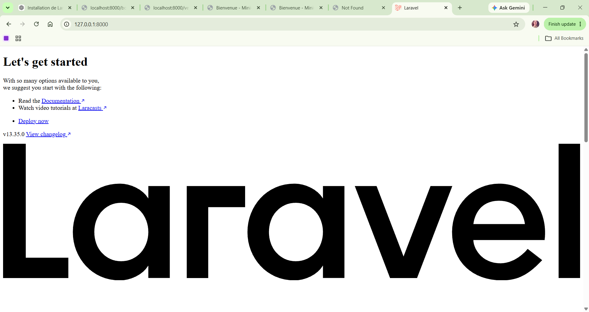
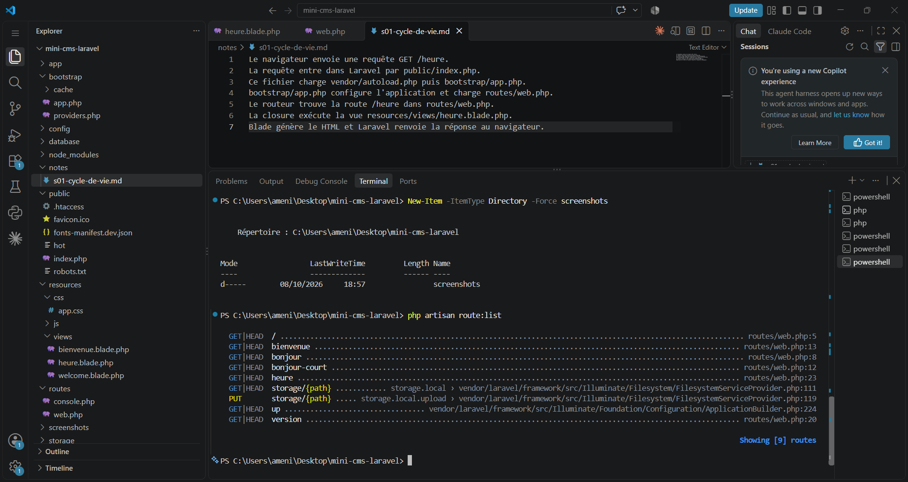
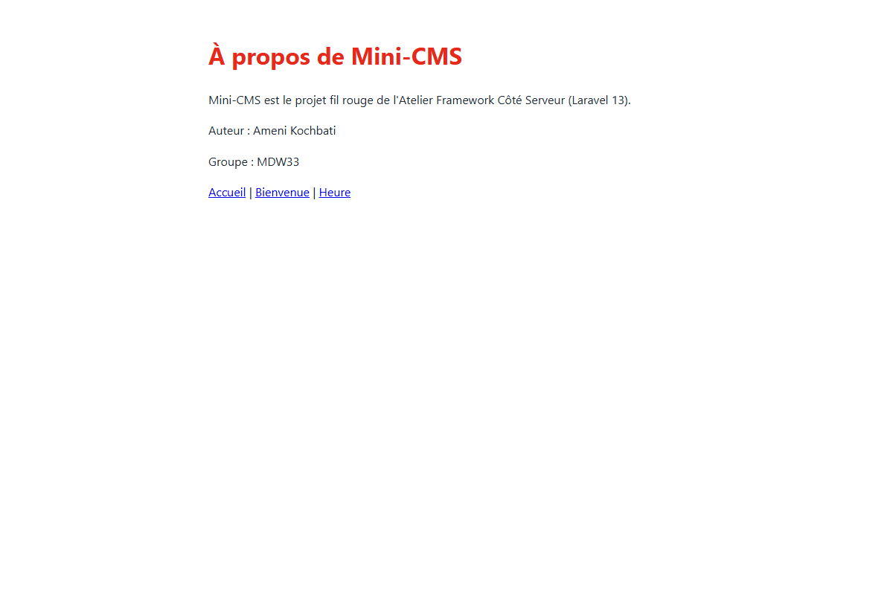
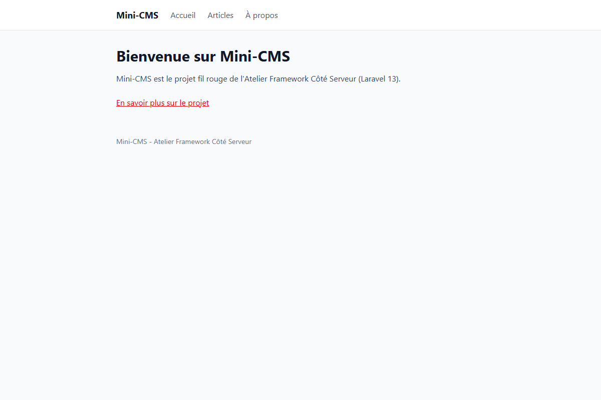
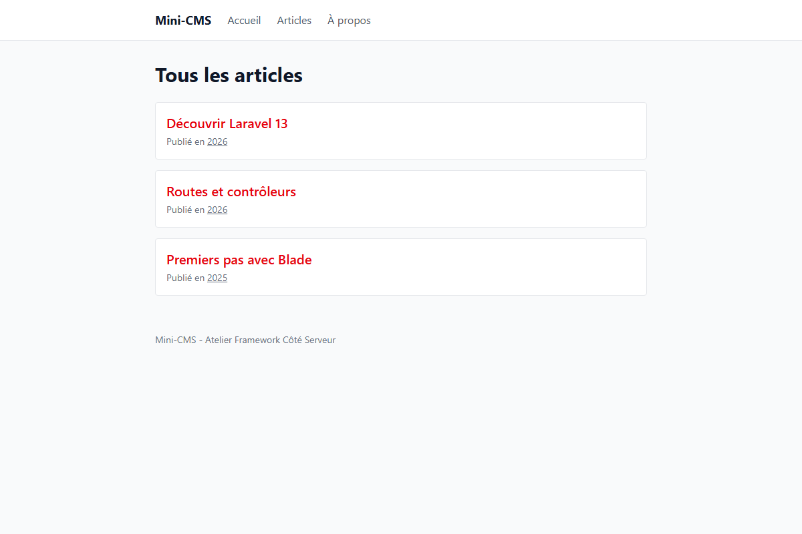
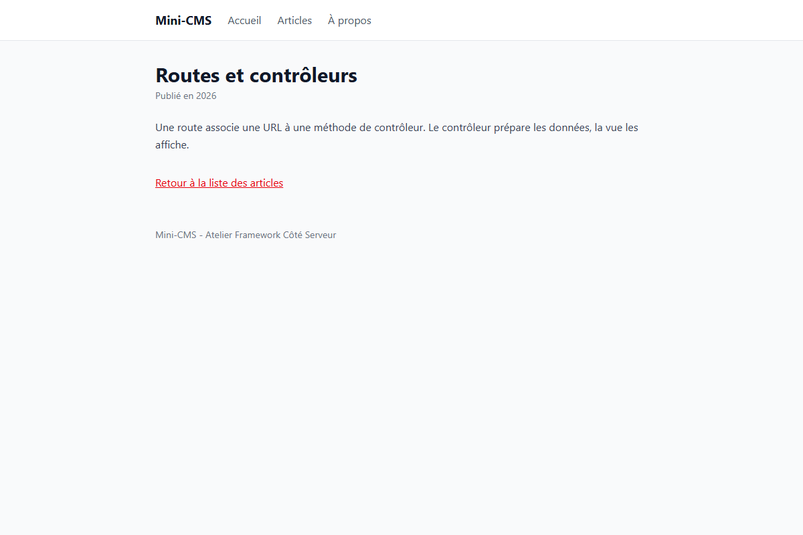

# Mini-CMS

Projet fil rouge de l'Atelier Framework Côté Serveur (Laravel 13, PHP 8.3+), 3e année MDW, ISET Sidi Bouzid.

Auteur : Ameni Kochbati, groupe MDW33.

Mini-CMS évoluera au fil du semestre vers une petite plateforme de publication : pages publiques, back-office authentifié, API JSON et tests Pest. Chaque session se termine par un tag Git (`lab-01`, `lab-01b`, puis un tag par session).

## État actuel (tag lab-07)

- Middleware `admin` (`App\Http\Middleware\EnsureUserIsAdmin`) sur tout `/admin` : un auteur reçoit 403 « Réservé aux administrateurs. ».
- Gate `manage-tags`, comme `manage-categories` : contrôleur, Form Requests et menu.
- Brouillons protégés : `PostPolicy::view` et le scope `visibleTo` ; un brouillon n'est visible que par son auteur et les administrateurs.
- API JSON en lecture seule, installée avec `php artisan install:api` (Sanctum installé ; les jetons arrivent en session 14).
- `GET /api/posts` : articles publiés, paginés (`?per_page=` de 1 à 50, 5 par défaut), avec auteur, catégorie et tags.
- `GET /api/posts/{post}` : un article publié ; un brouillon renvoie 403 et un numéro inconnu 404, en JSON.
- Réponses mises en forme par `PostResource` et `CategoryResource` : ni e-mail ni rôle des auteurs, dates ISO 8601.
- Tests d'autorisation : `AdminAccessTest`, `PostVisibilityTest` et `Api\PostApiTest`.

## Données de démonstration

Après un clone, reconstruire la base avec `php artisan migrate:fresh --seed`. Attention : cette commande vide la base avant de la remplir.

## Routes disponibles

| Méthode | URI | Nom | Action |
|---|---|---|---|
| GET | `/` | `home` | `PageController@home` |
| GET | `/a-propos` | `about` | `PageController@about` |
| GET | `/heure` | `time` | `PageController@time` |
| GET | `/posts` | `posts.index` | `PostController@index` |
| GET | `/posts/archive/{year}` | `posts.archive` | `PostController@archive` |
| GET | `/posts/create` | `posts.create` | `PostController@create` |
| POST | `/posts` | `posts.store` | `PostController@store` |
| GET | `/posts/{post}` | `posts.show` | `PostController@show` |
| GET | `/api/posts` | `api.posts.index` | `Api\PostController@index` |
| GET | `/api/posts/{post}` | `api.posts.show` | `Api\PostController@show` |

## Prérequis

- PHP et Composer (PHP 8.3 ou plus depuis https://www.php.net/downloads, avec les extensions curl, fileinfo, mbstring, openssl, pdo_sqlite, sqlite3 et zip activées dans php.ini, et Composer depuis https://getcomposer.org).
- Node.js LTS et npm.
- Git.

## Installation

### Bash (Git Bash, macOS, Linux)

```bash
git clone https://github.com/amenikochbati/mini-cm--larave.git
cd mini-cm--larave
composer install
npm install
cp .env.example .env
php artisan key:generate
touch database/database.sqlite
php artisan migrate
composer run dev
```

### PowerShell (Windows)

```powershell
git clone https://github.com/amenikochbati/mini-cm--larave.git
cd mini-cm--larave
composer install
npm install
copy .env.example .env
php artisan key:generate
New-Item database\database.sqlite -ItemType File
php artisan migrate
composer run dev
```

Ouvrir ensuite http://localhost:8000 (adresse de l'application, différente de l'adresse de Vite sur le port 5173).

## Captures d'écran

### Page d'accueil



### Liste des routes



### Page À propos



### Accueil avec le layout



### Liste des articles



### Détail d'un article



### Session 05


### Session 07


