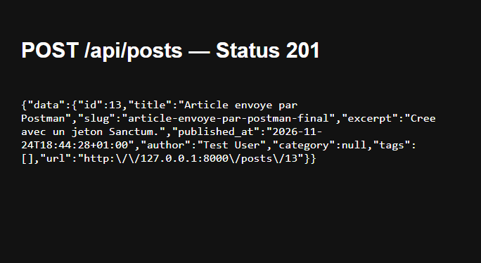
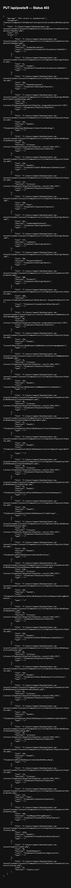

# Mini-CMS

Projet fil rouge de l'Atelier Framework Côté Serveur (Laravel 13, PHP 8.3+), 3e année MDW, ISET Sidi Bouzid.

Auteur : Ameni Kochbati, groupe MDW33.

## Description

Mini-CMS est une application de publication avec des pages publiques, un back-office protégé par rôles, des catégories, des tags, des brouillons, des tests Pest et une API REST JSON en lecture et écriture. L'API utilise Sanctum pour l'authentification par jetons.

## Fonctionnalités

- Gestion des articles, catégories et tags.
- Authentification, rôles administrateur/auteur et autorisations par Policy/Gate.
- Brouillons visibles uniquement par leur auteur et les administrateurs.
- API paginée avec filtres par catégorie et tag.
- Ressources JSON, validation française, erreurs 401/403/404/422.
- Authentification API par jetons Bearer Sanctum.

## Installation

### Bash

```bash
git clone https://github.com/amenikochbati/mini-cm--larave.git
cd mini-cm--larave
composer install
npm install
npm run build
cp .env.example .env
php artisan key:generate
php artisan migrate:fresh --seed
php artisan test
composer run dev
```

### PowerShell

```powershell
git clone https://github.com/amenikochbati/mini-cm--larave.git
cd mini-cm--larave
composer install
npm install
npm run build
copy .env.example .env
php artisan key:generate
php artisan migrate:fresh --seed
php artisan test
composer run dev
```

Si Artisan demande la création de `database/database.sqlite`, confirmez avec `yes`.

## Comptes de test

- Administrateur : `test@example.com`, mot de passe `password`.
- Les auteurs sont créés par les factories et le seeder. Leur mot de passe est `password`.

## API

### Endpoints

| Méthode | URI | Nom |
|---|---|---|
| GET | `/api/posts` | `api.posts.index` |
| GET | `/api/posts/{post}` | `api.posts.show` |
| POST | `/api/posts` | `api.posts.store` |
| PUT/PATCH | `/api/posts/{post}` | `api.posts.update` |
| DELETE | `/api/posts/{post}` | `api.posts.destroy` |
| GET | `/api/categories` | `api.categories.index` |
| GET | `/api/categories/{category}` | `api.categories.show` |
| GET | `/api/tags` | `api.tags.index` |
| GET | `/api/tags/{tag}` | `api.tags.show` |
| POST | `/api/login` | `api.login` |
| POST | `/api/logout` | `api.logout` |

Les filtres disponibles sur `/api/posts` sont `?per_page=`, `?category=<slug>` et `?tag=<slug>`.

### Authentification par jeton

Envoyez les identifiants à `POST /api/login`. Copiez la valeur `token` retournée et utilisez-la dans chaque requête protégée :

```text
Authorization: Bearer VOTRE_JETON
Accept: application/json
```

### Codes d'erreur

- `401` : jeton absent, invalide ou révoqué.
- `403` : utilisateur authentifié mais non autorisé.
- `404` : article, catégorie ou tag introuvable.
- `422` : paramètres ou données du formulaire invalides.

### Exemple curl.exe

```powershell
curl.exe -X POST -H "Accept: application/json" -H "Authorization: Bearer VOTRE_JETON" http://localhost:8000/api/logout
```

La déconnexion retourne `204 No Content`.

## Captures d'écran

### Session 13


### Session 14





## Choix d'architecture

### Pourquoi les écritures de l'API passent par PostPolicy

Une seule `PostPolicy` décide qui peut modifier ou supprimer un article. Le site et l'API utilisent donc les mêmes règles : un auteur ne peut pas agir sur l'article d'une autre personne, tandis qu'un administrateur conserve ses droits. Cela évite qu'une API écrive directement dans la base en contournant les autorisations du site.

### Pourquoi preventLazyLoading est activé

`preventLazyLoading` transforme les chargements paresseux en erreurs visibles pendant le développement. Une liste qui lit une relation sans `with()` peut alors provoquer une requête SQL supplémentaire par élément, le problème N+1. Les contrôleurs chargent donc les relations utiles explicitement.

### Pourquoi l'API utilise des jetons et non la session

Le groupe `api` n'utilise ni cookie de session ni CSRF. Une application mobile, un script ou Postman présente donc un jeton Sanctum à chaque requête. Ce jeton peut être révoqué indépendamment des autres appareils, sans modifier la connexion au site.
